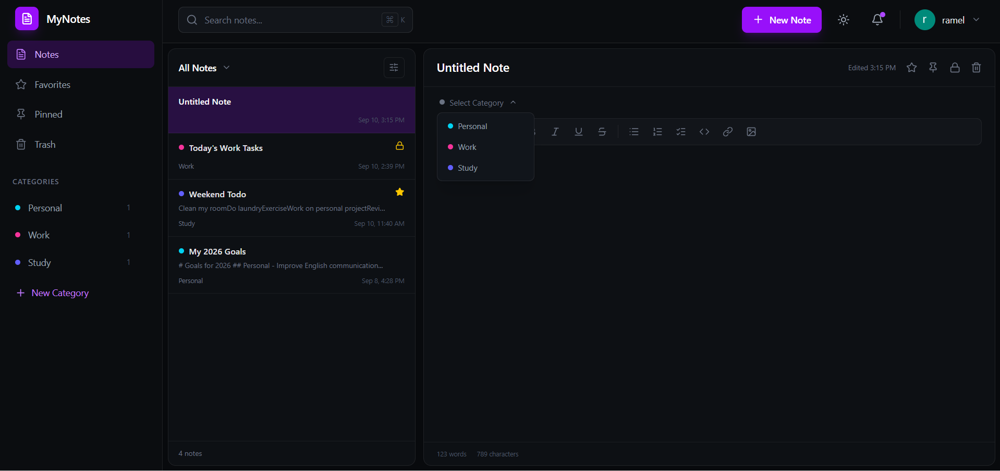
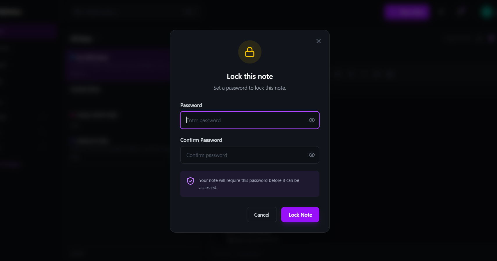
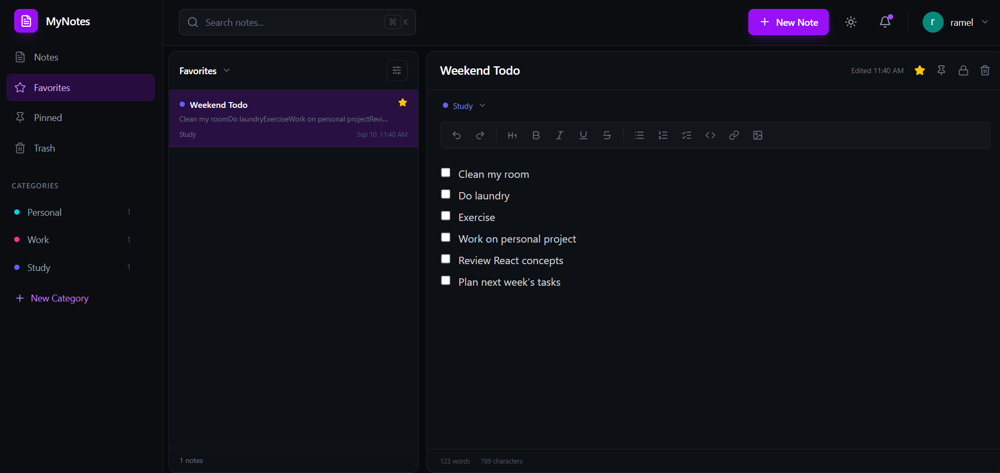
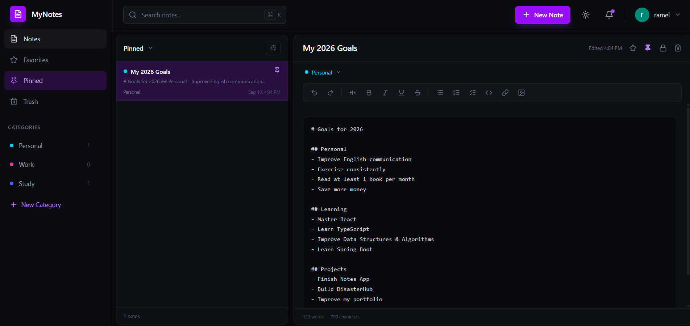
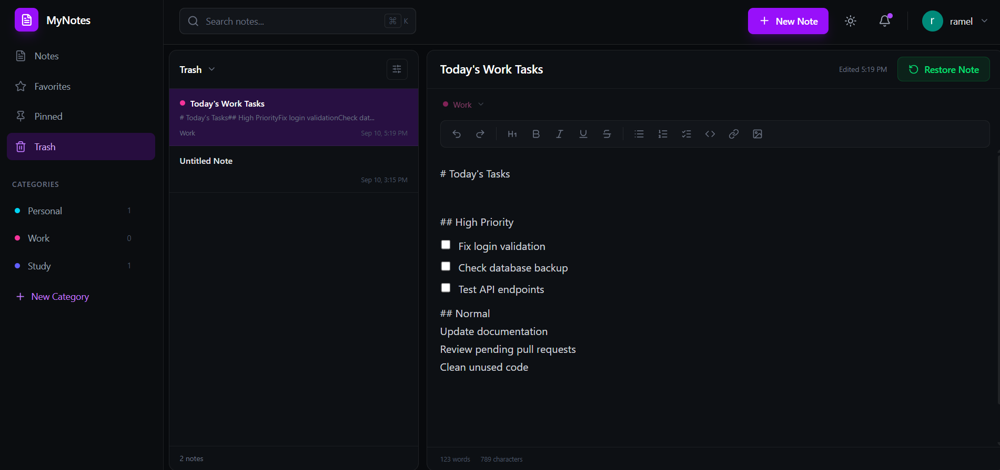

# 📝 MyNotes

A modern note-taking platform for organizing personal, work, and programming notes. MyNotes automatically detects the programming language of pasted code and applies matching syntax highlighting and editor themes, making code snippets easy to read and organize.

**🔗 Live Demo:** [mynotes-ramel.netlify.app](https://mynotes-ramel.netlify.app/)

---

## ✨ Features

- **Create and organize notes** with custom categories
- **Automatic language detection** for pasted code
- **Syntax highlighting** with code-specific editor themes
- **Favorites** – mark notes and view them in one place
- **Pinned notes** – pinned notes stay at the top of your list
- **Locked notes** – protect private notes with a password
- **Trash** – deleted notes can be restored with one click
- **Authentication** – secure sign up and sign in with Clerk

## 📸 Screenshots

<!-- Replace these paths with your own screenshots -->
| New Note & Categories | Locked Notes |
| :---: | :---: |
|  |  |

| Favorites | Pinned | Trash |
| :---: | :---: | :---: |
|  |  |  |

## 🛠️ Tech Stack

| Layer | Technologies |
| --- | --- |
| Frontend | React (Vite), Tailwind CSS |
| Backend | Node.js, Express |
| Database | Supabase |
| Authentication | Clerk |
| Hosting | Netlify (frontend) |

## 📁 Project Structure

```
MyNotes/
├── backend/
│   ├── controllers/
│   │   ├── categoriesController.js
│   │   └── notesController.js
│   ├── lib/
│   │   └── supabase.js
│   ├── middleware/
│   │   └── auth.js
│   ├── routes/
│   │   ├── categoriesRoutes.js
│   │   └── notes.js
│   ├── package.json
│   └── server.js
└── frontend/
    ├── public/
    ├── src/
    │   ├── assets/
    │   ├── components/
    │   │   ├── auth/
    │   │   ├── layout/
    │   │   └── notes/
    │   ├── config/
    │   ├── layouts/
    │   ├── pages/
    │   │   ├── Notes.jsx
    │   │   ├── SignIn.jsx
    │   │   └── SignUp.jsx
    │   ├── App.jsx
    │   ├── index.css
    │   └── main.jsx
    ├── index.html
    ├── package.json
    └── vite.config.js
```

## 🚀 Getting Started

### Prerequisites

- [Node.js](https://nodejs.org/) v18 or later
- A [Supabase](https://supabase.com/) project
- A [Clerk](https://clerk.com/) application

### 1. Clone the repository

```bash
git clone https://github.com/Ramelzkie96/MyNotes.git
cd MyNotes
```

### 2. Set up the backend

```bash
cd backend
npm install
```

Create a `.env` file in the `backend` folder:

```env
PORT=5000
SUPABASE_URL=your_supabase_project_url
SUPABASE_KEY=your_supabase_service_key
CLERK_SECRET_KEY=your_clerk_secret_key
```

Start the server:

```bash
npm run dev
```

### 3. Set up the frontend

```bash
cd frontend
npm install
```

Create a `.env` file in the `frontend` folder:

```env
VITE_CLERK_PUBLISHABLE_KEY=your_clerk_publishable_key
VITE_API_URL=http://localhost:5000
```

Start the development server:

```bash
npm run dev
```

The app will be available at `http://localhost:5173`.

> **Note:** Environment variable names above are examples. Match them to the ones used in your `supabase.js`, `auth.js`, and `config` files.

## 🔌 API Overview

| Resource | Description |
| --- | --- |
| `/api/notes` | Create, read, update, pin, favorite, lock, trash, and restore notes |
| `/api/categories` | Create, list, and delete categories |

All routes are protected by the authentication middleware in `backend/middleware/auth.js`.

## 🗺️ Roadmap

- [ ] Note search
- [ ] Export notes (Markdown / PDF)
- [ ] Note sharing

## 👤 Author

**Ramel**
GitHub: [@Ramelzkie96](https://github.com/Ramelzkie96)

## 📄 License

This project is open source and available under the [MIT License](LICENSE).
